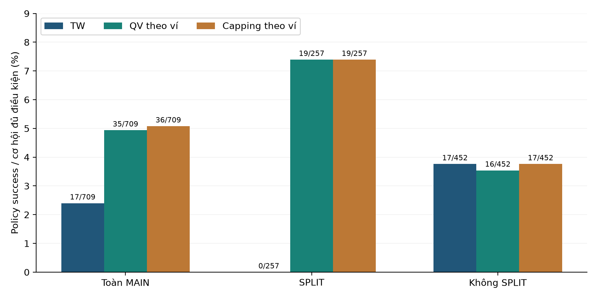
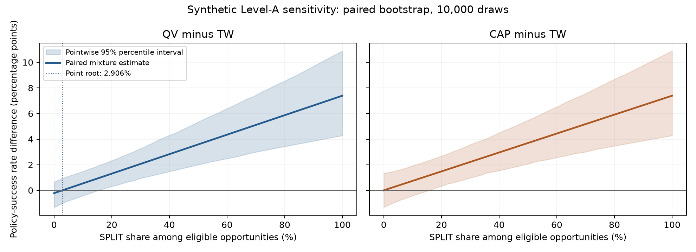
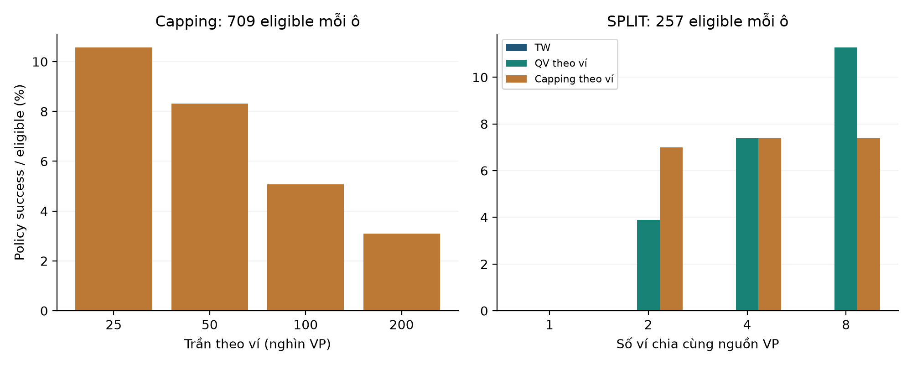
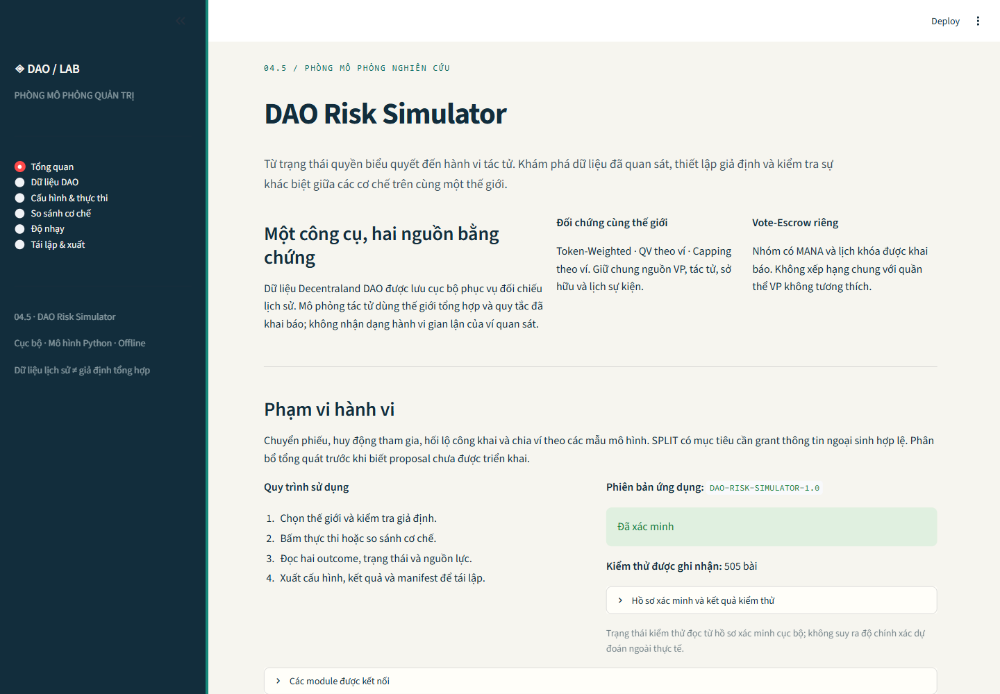

# Chương 4. Xây dựng mô hình mô phỏng và đánh giá các cơ chế biểu quyết

Chương 3 xác định tác tử, lợi ích và ràng buộc nguồn lực, đồng thời phân tích điều kiện làm thay đổi kết quả biểu quyết. Chương này chuyển các cấu trúc đó thành mô hình có thể thực thi, kiểm tra cách tính phiếu và khảo sát các tình huống tổng hợp. Mục tiêu là giải thích sự phụ thuộc của kết quả vào cơ chế, nguồn lực và thông tin, không nhận diện hành vi thao túng đã xảy ra tại Decentraland.

Nghiên cứu tách dữ liệu quan sát, kết quả tính lại, phản thực tế cơ học và thế giới tổng hợp. Phát lại phiếu quan sát không phải dự báo hành vi. Thay trọng số trên cùng phiếu không phải một thí nghiệm tấn công. Các tỷ lệ Monte Carlo là tần suất trong phân phối giả định, không phải xác suất DAO bị thao túng ngoài thực tế. Ranh giới này được giữ trong toàn bộ các mục và công cụ trình diễn.

## 4.1. Thiết kế mô hình ABM

### 4.1.1. Khởi tạo mạng lưới tác tử

Mô hình được mô tả theo cấu trúc ODD của Grimm và cộng sự, nhằm làm rõ mục đích, thực thể, lịch sự kiện, giả định và cách kiểm chứng [T1]. Đơn vị ghi nhận phiếu là ví i trên đề xuất j. Chủ thể nguồn lực p là một thực thể khác: nhiều ví có thể cùng trỏ đến một tài khoản của p khi kịch bản khai báo cùng kiểm soát. Ánh xạ này là giả định mô hình, không xác minh một địa chỉ tương ứng với một người.

Môi trường mỗi đề xuất lưu choices, thời gian mở và đóng, snapshot, strategy, quy tắc ứng viên và cờ bằng chứng. Trạng thái ví–đề xuất giữ VP, lựa chọn, quyền và thời điểm biết thông tin. Tài khoản nguồn lực quản lý tiền theo chủ thể, tránh cấp lại ngân sách khi tạo ví phụ. VP là quyền biểu quyết của đúng đề xuất, không phải tài sản tiền mặt cố định suốt đời của ví.

**Bảng 4.1. Các phạm vi dữ liệu và đối chứng được giữ riêng**

| Phạm vi | Kích thước | Mục đích và giới hạn |
|---|---:|---|
| B binding lịch sử | 1.023 đề xuất, 63.662 phiếu, 6.004 ví | Tái dựng phiếu được giữ; không phải toàn bộ eligible universe |
| Đối chứng trọng số lịch sử | 943 đề xuất | Đủ điều kiện QV/Capping theo metadata và họ quy tắc; 80 đề xuất còn lại vẫn được lưu |
| MAIN tổng hợp | 1.000 world | TW/QV/Capping dùng cùng world; không coi ba lượt cơ chế là ba mẫu độc lập |
| VE tổng hợp | 200 world | Có MANA và lịch sử khóa riêng; không xếp hạng chung với MAIN |
| Type B 4.4 | 56 ô, 27.034 dòng world–cấu hình | Dùng lại world nguồn, không phải 27.034 world độc lập |

Nguồn: hồ sơ khởi tạo, kết quả QV/Capping, hợp đồng Monte Carlo và kiểm toán 4.4 V2. “Phiếu” trong tập lịch sử là các bản ghi còn lưu, chưa chứng minh có toàn bộ lịch thay phiếu.

Hai chế độ khởi tạo được phân biệt. Chế độ A giữ hàng đợi phiếu quan sát cho bộ kiểm phát lại. Chế độ B không cấp trước lịch tham gia hoặc lựa chọn tương lai cho tác tử. Quyền, VP, tiền hoặc utility thiếu vẫn chưa biết; không mặc định thành 0. Các quan hệ delegation cần chứng cứ lịch sử và thời điểm hiệu lực. Quan sát delegation hiện tại không được dùng để dựng một mạng ảnh hưởng trong quá khứ.

Thời gian được xử lý theo giây. Sự kiện cùng thời điểm được kiểm và cập nhật theo lô để thứ tự dòng CSV không tạo lợi thế thông tin. Archive và thống kê cuối chỉ thuộc bộ kiểm, không mặc nhiên thuộc thông tin tác tử. Kết quả phát lại trùng Baseline trên 1.023/1.023 đề xuất xác nhận tính nhất quán cơ học, không chứng nhận phiên bản production hoặc toàn bộ quyền scoring lịch sử.

### 4.1.2. Luật hành vi của các tác tử

Tác tử so sánh hành động khả thi với phương án cơ sở tại cùng thời điểm. Phương án cơ sở là chờ hoặc giữ phiếu hiện hành. Kế thừa Chương 3, chỉ hành động có lợi ích tăng thêm vượt ngưỡng cảm nhận epsilon mới được thực hiện. Epsilon không bị trừ thêm như một khoản chi phí. Utility dựa trên giá trị trạng thái và niềm tin chủ quan khai báo, tách chi phí tiền, nguồn lực và rủi ro theo đúng đơn vị.

Ngân sách dùng chung theo chủ thể p. Chuyển giao, phí, escrow và hoàn trả được hạch toán đúng một lần; không dùng một khoản tiền đã cam kết cho nhiều ví cùng lúc. Phiếu thay thế phải loại đóng góp cũ trước khi thêm đóng góp mới. Total VP đã gồm thành phần strategy và delegation, nên không được cộng các thành phần đó lần nữa.

Trong fixture kiểm phần mềm, bốn tác tử và hai đề xuất tạo chín quyết định, gồm ba bỏ phiếu lần đầu, một thay phiếu, hai giữ và ba chờ. Trace này kiểm sự kết nối giữa khởi tạo, thông tin và hành động, không ước lượng động cơ ví lịch sử. Các thí nghiệm sau tiếp tục dùng niềm tin và quy tắc phản ứng được khai báo. Chúng không tự giải một cân bằng Nash hay SPNE tổng quát, cũng chưa mô hình hóa học hỏi hoặc tiến hóa quần thể dài hạn.

## 4.2. Các cơ chế biểu quyết

### 4.2.1. Baseline Token-Weighted Voting

Với tập ví có phiếu cuối B_j, lựa chọn c_ij và Total VP hợp lệ w_ij, tổng điểm theo lựa chọn k là:

$$
S_{jk}=\sum_{i\in B_j}w_{ij}\mathbf{1}\{c_{ij}=k\}.\tag{4.1}
$$

Tally này được tách khỏi quy tắc thông qua, trạng thái quản trị quan sát và việc thực thi. Đối với lịch sử, nghiên cứu dùng quy tắc Governance ứng viên và ngưỡng của đúng phạm vi đã đối soát; không thay tất cả bằng một quy tắc nhị phân hiện tại. Đối với đối chứng cơ chế giả định, một chính sách chung được khai báo riêng.

Trên B binding, tally và outcome ứng viên trùng Baseline ở 1.023/1.023 đề xuất, nhưng chỉ 1.016/1.023 khớp nhãn quản trị quan sát. Bảy sai khác, 49 khoảng trống DEFAULT và 10 cờ ngân sách được giữ nguyên. Những cờ này có thể chồng nhau. Mức khớp khoảng 99,32% không phải xác suất chống tấn công hay chứng cứ deployment đã được xác minh.

### 4.2.2. Quadratic Voting

QV trong nghiên cứu là biến thể căn bậc hai theo ví, dùng hết ngân sách tín dụng giả định của một ví cho một lựa chọn. Nó không bao gồm toàn bộ bài toán lựa chọn cường độ và phân bổ tín dụng của QV cổ điển [T2]. Với u=1 VP, các trọng số của ba cơ chế trên nguồn VP được định nghĩa:

$$
w_{ij}^{TW}=w_{ij}, \qquad
w_{ij}^{QV}=\sqrt{w_{ij}/u}, \qquad
w_{ij}^{CAP}=\min(w_{ij}, C_{cap}).\tag{4.2}
$$

TW và Capping giữ đơn vị VP; QV dùng điểm tín dụng căn bậc hai. Không dùng VP threshold lịch sử làm quorum cho điểm QV. Biến thể này cũng không đồng nhất với toàn bộ quy trình bình phương và chuẩn hóa của mã QV Snapshot được lưu theo commit [T3]. Mã thực thi căn thực và kiểm dấu bằng chứng nhận số học, không làm tròn xuống số nguyên; số thập phân hiển thị không tự quyết định thắng thua.

Đối chứng cơ học trên 943 đề xuất giữ cùng phiếu, choices và nguồn VP, áp dụng chính sách giả định Yes có điểm lớn hơn No, không có quorum tuyệt đối. Hòa, không phiếu hoặc tổng điểm 0 dẫn đến từ chối. Đây không phải quy tắc Governance lịch sử được xác nhận.

**Bảng 4.2. Outcome theo cùng chính sách đa số giả định trên 943 đề xuất**

| Cơ chế | Chấp nhận | Từ chối | Khác TW theo chính sách chung |
|---|---:|---:|---:|
| TW | 520 | 423 | 0 |
| QV theo ví | 535 | 408 | 37 |
| Capping 100.000 VP/ví | 534 | 409 | 40 |

Nguồn: QV_RESULTS.csv và CAPPING_RESULTS.csv. Đơn vị đếm là đề xuất. Có 80/1.023 đề xuất không được đánh giá theo chính sách chung, không phải bị loại sau khi xem kết quả.

Nếu so QV với outcome ứng viên lịch sử thì có 169 đề xuất đổi kết quả. Phép so đó đổi cả trọng số lẫn điều kiện thông qua; 37 mới là số thay đổi chỉ do trọng số dưới chính sách chung. Đổi riêng chính sách với VP tuyến tính làm 142 đề xuất đổi outcome. Các số này có giao nhau và không được cộng thành một phân rã của 169. Chúng không đo hiệu quả phòng thủ.

### 4.2.3. Vote-Escrow và Capping

Capping áp trần theo ví sau khi tổng hợp Total VP, không phân bổ lại phần vượt trần. C_cap=100.000 VP là giả định nghiên cứu chốt trước lần tính đầu, không phải một mức trần lịch sử của Decentraland. Theo chính sách chung, Capping làm 40 đề xuất đổi outcome so với TW, gồm 13 chuyển chấp nhận sang từ chối và 27 theo chiều ngược lại. So với outcome ứng viên lịch sử có 176 thay đổi, nhưng phép so này thay cả trọng số lẫn quy tắc.

Khi chỉ chia cùng một nguồn VP qua các ví cùng lựa chọn, TW bảo toàn tổng điểm. QV có thể tăng tổng căn, còn Capping có thể nâng tổng phần quyền được tính dưới nhiều trần. Đó là tính chất của biến thể theo ví, không chứng minh mọi QV hoặc mọi Capping đều kém an toàn. Cần phân biệt giới hạn theo ví với giới hạn theo chủ thể.

Vote-Escrow sử dụng nguồn MANA khóa được khai báo riêng. Tham khảo nguyên lý suy giảm tuyến tính theo thời gian còn lại của Curve [T4], nghiên cứu định nghĩa:

$$
w_i^{VE}(t_s)=\kappa L_i(t_s)
\frac{\max(T_i(t_s)-t_s, 0)}{T_{max}}, \tag{4.3}
$$

trong đó L_i là MANA khóa hợp lệ, T_i là lúc hết hạn, t_s là snapshot và kappa=1 điểm VE/MANA. Đơn vị kết quả là VE_MANA_POINT. Thời lượng tối đa 31.536.000 giây và tối thiểu 86.400 giây là giả định riêng, không sao chép giới hạn bốn năm của Curve. CREATE, INCREASE, EXTEND và WITHDRAW phải tuân thủ quyền kiểm soát, tài sản và thời gian. Khóa làm giảm liquid và tăng locked, không đốt principal hoặc tạo tiền mới.

Không có chuỗi dữ liệu khóa lịch sử đủ chứng cứ cho Decentraland trong hồ sơ, nên không suy VE từ Total VP, tuổi ví hay thời điểm bỏ phiếu. Các kịch bản tổng hợp kiểm ledger và snapshot được dùng riêng. Sự kiện sau snapshot không làm thay đổi ngược quyền đã chốt. Hiệu quả phòng thủ của VE không được xác nhận chỉ bằng các fixture cơ học này.

## 4.3. Thí nghiệm Monte Carlo

### 4.3.1. Đặt vấn đề và Mục tiêu Thí nghiệm

Thí nghiệm khảo sát cách luật trọng số kết hợp với tình huống và điều kiện thông tin đã khai báo làm thay đổi outcome. Bốn họ trong MAIN gồm đổi phiếu trong quyền hiện có, hối lộ công khai có điều kiện, huy động quyền sẵn có và chia nguồn trước snapshot, lần lượt ký hiệu SWITCH, BRIBE_E, MOBILIZE và SPLIT. Các nhãn này chỉ dùng cho thế giới tổng hợp, không gán cho ví quan sát.

Nghiên cứu dùng phương án không can thiệp làm đối chứng của cùng world. Một đề xuất đã đạt mục tiêu ở nhánh nền không được quy là thành công do can thiệp. Các trường hợp không khả thi, thiếu đặc tả và tự từ chối kinh tế được tách khỏi hành động đã thực hiện nhưng thất bại.

### 4.3.2. Thiết kế Thí nghiệm và Khung Đo lường Thống kê

Master seed 4302027 tạo 1.000 world MAIN. Mỗi world giữ chung ví, chủ thể, nguồn VP, ngân sách, utility, niềm tin và lịch khi chạy TW/QV/Capping. Nhóm VE gồm 200 world có MANA/lịch khóa riêng. Tổng cộng có 3.200 lượt cơ chế trên 1.200 world nguồn; không gọi đó là 3.200 mẫu độc lập.

Đặt E là số cơ hội đủ điều kiện, A là số hành động được thực hiện và K là số policy success. Hai tỷ lệ chính là:

$$
R_E=K/E, \qquad R_A=K/A, \quad\text{chỉ xác định khi mẫu số dương}.\tag{4.4}
$$

Policy success đòi hỏi can thiệp làm nhánh nền từ REJECTED chuyển sang ACCEPTED theo mục tiêu khai báo. Chỉ tiêu thứ ba dùng số lượt đã thực hiện có baseline bị từ chối làm mẫu số. Chỉ tiêu thứ tư ghi mục tiêu đã đạt sẵn trong các lượt thực hiện. Những mẫu số khác nhau trả lời các câu hỏi khác nhau và không thay thế nhau.

Các tỷ lệ nhị phân của đợt 4.3 được báo với khoảng Wilson 95%; chênh lệch cơ chế dùng bootstrap ghép cặp theo world. Niềm tin và luật phản ứng vẫn là giả định. Đối chứng giữ chúng cố định giúp xác định tác động trong cấu hình đã chốt, chưa chứng minh phản ứng tối ưu nội sinh trước mọi cơ chế.

### 4.3.3. Kết quả Thực nghiệm Bốn Chỉ tiêu Đo lường

Trong MAIN, 709/1.000 world đủ điều kiện, 291 không khả thi. Trong 709 cơ hội, tác tử từ chối ở 321 và thực hiện ở 388 world. VE có 128/200 cơ hội đủ điều kiện, 67 từ chối và 61 thực hiện.

**Bảng 4.3. Thành công có điều kiện trong các thế giới tổng hợp**

| Nhóm/cơ chế | K/E | R_E | Wilson 95% cho R_E | K/A | K / lượt thực hiện có baseline REJECTED |
|---|---:|---:|---|---:|---:|
| MAIN/TW | 17/709 | 2,40% | [1,50%; 3,81%] | 17/388 | 17/155 |
| MAIN/QV | 35/709 | 4,94% | [3,57%; 6,79%] | 35/388 | 35/150 |
| MAIN/CAP | 36/709 | 5,08% | [3,69%; 6,95%] | 36/388 | 36/168 |
| VE, nhóm riêng | 6/128 | 4,69% | [2,17%; 9,85%] | 6/61 | 6/27 |

Nguồn: MC_MAIN_RESULTS.csv và MC_MAIN_SUMMARY.json, kiểm lại trong MC_NUMERICAL_RECONCILIATION.csv. Đơn vị quan sát là world trong đúng nhóm, tỷ lệ làm tròn để trình bày. VE không nằm trong phép xếp hạng MAIN.

Tỷ lệ trên attempted tương ứng là 4,38%, 9,02%, 9,28% và 9,84%. Mục tiêu đã đạt sẵn ở baseline trong 233/388 lượt TW, 238/388 QV, 220/388 CAP và 34/61 VE. Việc tách nhóm này ngăn quy kết mọi nhánh ACCEPTED cho hành động tấn công.

### 4.3.4. Phân tích Ghép cặp và Mức độ Phụ thuộc vào Họ Tấn công

**Bảng 4.4. Chênh lệch policy success ghép cặp trong 709 cơ hội MAIN**

| Cặp, chiều sau trừ trước | Chênh lệch điểm % | Bootstrap 95%, điểm % |
|---|---:|---|
| QV − TW | +2,54 | [+1,27; +3,95] |
| CAP − TW | +2,68 | [+1,27; +4,23] |
| CAP − QV | +0,14 | [−0,99; +1,27] |

Nguồn: PAIRED_COMPARISONS.json. Khoảng chứa 0 của CAP−QV không phải bằng chứng tương đương; đây là khoảng bất định của chênh lệch trong phân phối tổng hợp đã chọn.

**Bảng 4.5. Số policy success theo họ trên cơ hội đủ điều kiện**

| Họ | E | TW | QV | CAP |
|---|---:|---:|---:|---:|
| SWITCH | 177 | 10 | 8 | 8 |
| BRIBE_E | 95 | 4 | 4 | 4 |
| MOBILIZE | 180 | 3 | 4 | 5 |
| SPLIT | 257 | 0 | 19 | 19 |
| Không SPLIT, tổng ba họ đầu | 452 | 17 | 16 | 17 |

Nguồn: MC_FAMILY_COUNTS.csv, tính lại từ MC_MAIN_RESULTS.csv. Hàng cuối không cộng thêm vào bốn hàng họ.

**Hình 4.1.** Tỷ lệ policy success trên eligible của MAIN và hai tầng. Nhãn cột ghi tử số/mẫu số; ba nhóm không phải các quần thể có cùng mẫu số. Nguồn: FIG_4_1_SOURCE.csv. Không có VE trong đồ thị.

Chênh lệch tổng thể phụ thuộc mạnh vào SPLIT. Trong ba họ còn lại, số ca gần nhau không đủ kết luận các cơ chế tương đương. Ở nhóm không SPLIT, QV và TW có 2 world chỉ QV thành công và 3 world chỉ TW thành công; CAP và TW có 4 world riêng cho mỗi phía. Tổng ca bằng nhau không có nghĩa thành công trên cùng world.

SPLIT nhắm proposal cần biết kế hoạch trước công bố và hoàn tất phân bổ trước snapshot. Mã 4.3 ban đầu chưa xác minh grant theo cấu trúc. Kiểm toán 4.4 V2 bổ sung tiền đề thông tin ngoại sinh và kiểm tra rõ actor, nội dung và thời gian. Vì vậy kết quả 4.3 chỉ được dùng như kết quả có điều kiện theo giả định này, không phải bằng chứng về quyền biết trước của proposer thật.

### 4.3.5. Cấu trúc Chi phí Tài chính và Động học Thời gian

Chi phí tiền dùng TEST_COIN. Escrow không đồng nhất với chi phí ròng; tiền hoàn trả không bị tính mất lần nữa. Utility được giữ theo đơn vị cá nhân và hệ số chuyển đổi khai báo, không trộn với VP hoặc MANA.

**Bảng 4.6. Tiền ròng trung bình trên các ca thành công MAIN**

| Cơ chế | Số ca thành công | Tiền ròng trung bình/ca, TEST_COIN |
|---|---:|---:|
| TW | 17 | 1,88 |
| QV | 35 | 1,23 |
| CAP | 36 | 1,22 |

Nguồn: MC_COST_RECONCILIATION.csv. Đây là trung bình của các tập ca thành công khác nhau, không phải chi phí tối ưu lật một đề xuất cố định hoặc chi phí USD thực.

Thành phần SPLIT bổ sung các ca có chi phí thiết lập thấp, làm thay đổi trung bình gộp của QV/CAP. Không từ đó suy ra một kênh tấn công thực tế luôn rẻ hơn. Phí ngoài được khai báo trong mô hình, không gọi là gas đã đo trên blockchain.

Quyết định diễn ra sau 1–3 giây mô phỏng từ lúc đưa ra hành động trong các lượt đã thực hiện. Thời gian hoàn tất, đánh giá cuối và thời gian thực thi phần mềm là những đại lượng khác nhau. Động học ở đây phản ánh lịch và phản ứng trong một đề xuất, chưa phải diễn biến dài hạn của một DAO hay độ trễ giao dịch thực tế.

### 4.3.6. Mức độ Tập trung Quyền lực và Đánh giá Hệ số Gini

Gini cấp ví trung bình của các world MAIN lần lượt khoảng 0,255 ở TW, 0,142 ở QV và 0,125 ở CAP; HHI khoảng 0,371, 0,316 và 0,321. Các số này tính trên trọng số hiệu lực của các phiếu cuối theo định nghĩa model, không phải toàn bộ cử tri có quyền. Nhóm VE có phân phối và nguồn khác nên không dùng để xếp hạng mức an toàn chung.

Gini giảm mô tả mức chênh lệch giữa các ví dưới phép trọng số đã chọn. Nó không tự đo cấu trúc kiểm soát, liên minh hoặc khả năng tấn công. Trong mô hình có owner_map giả định, chỉ số cấp chủ thể được lưu riêng; việc có owner_map tổng hợp không xác minh danh tính ngoài thực tế. Không diễn giải quan hệ giữa Gini và success như một quan hệ nhân quả đã được nhận diện.

### 4.3.7. Khảo sát Độc lập về Cơ chế Vote-Escrow

VE có 6/128 policy success và 6/61 success trên attempted trong nhóm riêng. Quyền phụ thuộc đồng thời amount và thời gian còn lại, vì vậy kết quả cần đi cùng lịch sử khóa đã khai báo. Tình huống bị loại khỏi tập khả thi không được tính như một hành động đã thử và bị cơ chế đánh bại.

Chưa có dữ liệu khóa Decentraland đủ để xác nhận hiệu quả lịch sử hoặc chi phí cơ hội thật. Các kết quả này kiểm sự kết hợp giữa nguồn MANA giả định, lịch khóa và các họ được triển khai, không chứng minh ưu thế tuyệt đối của VE hay ngăn mọi tấn công ngắn hạn.

### 4.3.8. Kết luận Khoa học Mục 4.3

Thí nghiệm cho thấy thứ tự cơ chế phụ thuộc thành phần tình huống và quyền thông tin, không chỉ mức tập trung danh nghĩa. Trong cấu hình đã chọn, QV/CAP có thêm policy success do SPLIT, trong khi kết quả ba họ còn lại gần nhau và có bất định. Đây là kết luận trong không gian giả định, chưa đủ để đưa khuyến cáo triển khai tuyệt đối cho Decentraland. Mục 4.4 kiểm sự phụ thuộc này theo tham số và sửa các giới hạn thống kê của điểm giao.

## 4.4. Phân tích độ nhạy

### 4.4.1. Thành phần tình huống và điểm giao

Type A tái trọng số kết quả đã có. Đặt p là tỷ trọng SPLIT trong hỗn hợp cơ hội đủ điều kiện, khác với tỷ trọng SPLIT được sinh hoặc tần suất quan sát ở DAO. Với 257 cơ hội SPLIT và 452 cơ hội khác, chênh lệch QV−TW là:

$$
\Delta_{QV-TW}(p)=p\frac{19}{257}-(1-p)\frac{1}{452},
\qquad p^*=\frac{257}{8845}\approx2,9056\%.\tag{4.5}
$$

Bootstrap ghép cặp 10.000 lần, seed 4302029, giữ vector cơ chế của cùng world trong từng tầng. Có 7.565 draw với nghiệm duy nhất trong [0,1], tương ứng 75,65%; 2.435 draw có nghiệm ngoài miền. Không có draw song song hoặc trùng đường trong mẫu thực, nhưng bộ kiểm có xử lý những trường hợp này.

Percentile của nghiệm đại số trên trục thực là [−12,1456%; 15,3198%]. Giá trị âm biểu thị giao điểm ngoại suy, không phải tỷ trọng khả dĩ. Nếu chỉ giữ nghiệm hợp lệ, khoảng [0%; 15,9330%] là có điều kiện, không phải CI 95% vô điều kiện. Khoảng hẹp [1,8%; 4,5%] không được dữ liệu hỗ trợ và không được dùng.

**Hình 4.2.** Chênh lệch tỷ lệ QV−TW và CAP−TW theo p. Trục tung là điểm phần trăm; dương nghĩa policy success mô phỏng cao hơn TW. Vùng tô là khoảng percentile pointwise 95%, không phải dải đồng thời hoặc CI của p*. Nguồn: bảng 204 dòng và bootstrap đã kiểm toán 4.4 V2, giữ nguyên hình gốc.

Tại p*, khoảng chênh lệch QV−TW là [−1,0062; 0,9271] điểm phần trăm. Không thể kết luận thứ tự chắc chắn đảo đúng ở 2,91%. CAP−TW có đường điểm p·19/257, giao tại biên p=0, không có một ngưỡng nội miền giống QV−TW.

### 4.4.2. Quyền thông tin và chia ví

Kiểm toán phân biệt 282 world SPLIT được sinh, 257 eligible và 138 attempted. Type B giữ lại world nguồn 4.3 với seed thực 4302027; giá trị 4302028 từng ghi trong đăng ký/log không được truyền vào generator. Tái sử dụng world phục vụ ghép cặp, không tạo mẫu độc lập mới.

Grant informed là tiền đề tổng hợp có principal, role binding, issuer/source/scope, nội dung và hash. Thời gian phải thỏa known≤published<decision≤allocation<snapshot<created<start. Không chỉ chọn một chuỗi informed rồi cho phép hành động. Grant xác nhận khả thi của kế hoạch cấu hình sẵn; chưa có bộ tối ưu hóa kế hoạch từ nội dung thông tin riêng.

UNINFORMED không đủ điều kiện cho kế hoạch nhắm proposal cần biết trước. Phân bổ tổng quát từ trước, không nhắm proposal, chưa triển khai và được ghi NOT_READY, không kết luận bất khả thi. BLOCKED cần một quy tắc cấm ngoại sinh cụ thể. Hai nhánh không có eligible không được báo tỷ lệ 0%; các tỷ lệ đó không xác định.

Khi thay k=1/2/4/8 ví trên cùng nguồn, số policy success QV là 0/10/19/29; CAP là 0/18/19/19; TW đều 0. Mỗi ô có 257 eligible và 138 attempted. TW chỉ bất biến với phép chia cùng nguồn và cùng lựa chọn này, không miễn nhiễm mọi hình thức Sybil hoặc thao túng.

### 4.4.3. Trần và ngân sách

Capping 25.000/50.000/100.000/200.000 VP/ví có 75/59/36/22 policy success, mỗi ô trên 709 eligible và 388 attempted. Giảm trần cũng thay baseline và trọng số phía đối kháng, không chỉ năng lực attacker. So với trần 100.000, baseline đổi outcome ở 83/52/66 world cho ba mức 25.000/50.000/200.000. Do đó không suy ra mọi DAO có trần thấp đều kém an toàn.

**Hình 4.3.** Các ô Type B đã thực thi. Trái: cap trên 709 eligible. Phải: số ví SPLIT trên 257 eligible. Chỉ vẽ cột tại giá trị đã chạy, không nội suy kết quả giữa các mức. Nguồn: SENSITIVITY_RESULTS.csv đã được tái lập toàn bộ 56 ô.

**Bảng 4.7. Độ nhạy ngân sách, đơn vị tiền tổng hợp theo hệ số nguồn**

| Hệ số ngân sách | E | A | K_TW | K_QV | K_CAP |
|---|---:|---:|---:|---:|---:|
| 0,5× | 669 | 371 | 15 | 33 | 34 |
| 1× | 709 | 388 | 17 | 35 | 36 |
| 1,5× | 719 | 394 | 19 | 37 | 38 |
| 2× | 733 | 401 | 20 | 38 | 39 |

Nguồn: ATTACK_BUDGET_RESULTS.json, CSV gốc và tái chạy world 4.4 V2. Con số 745 trong văn bản cũ được sửa thành 733. Khi ngân sách đổi, tập eligible cũng đổi; không coi mọi chênh lệch tỷ lệ là tác động trên một mẫu eligible cố định. Tại 2×, tỷ lệ trên eligible là 2,7285%/5,1842%/5,3206%; trên attempted là 4,9875%/9,4763%/9,7257%.

Tương tác alias–cap được giữ trong phụ lục 16 ô. Theo thứ tự cap tăng dần, k1 có 0/0/0/0 success; k2 có 35/28/18/4; k4 và k8 cùng 52/40/19/4. Đây là các phép ghép cặp, không phải 16 mẫu độc lập để cộng quy mô.

### 4.4.4. Vote-Escrow

Ba ô cũ chỉ thay thời hạn từ CREATE, giữ amount. CREATE ở snapshot−10 giây, nên remaining thực là f·Tmax−10, không đúng bằng f·Tmax. Cả ba ô có 7/128 success so với 6/128 ở 4.3 vì thời hạn dị biệt được thay bằng thời hạn chung.

Đối chiếu từng world cho thấy mỗi factor làm 15 baseline và 16 nhánh có hành động đổi outcome, trong khi phản ứng và quyết định không đổi. Chỉ VE_0022, họ MOBILIZE, thêm policy success: baseline vẫn REJECTED nhưng nhánh huy động chuyển sang ACCEPTED do trọng số tương đối. Không có ca mất success. Chênh lệch 6→7 vì cấu hình khóa, không vì thêm hành động hay đổi seed.

Bổ sung đã đăng ký riêng gồm sáu ô kết hợp remaining khả thi 0,25/0,5/1 và amount 0,5/1, tổng 1.200 dòng. Mỗi ô có 128 eligible, 61 attempted và 7 success. Đây là co giãn đồng nhất; chưa khảo sát phân bố khóa dị biệt nội sinh. Kết quả bổ sung không thay ba ô cũ và không chứng minh VE không nhạy trong mọi điều kiện.

### 4.4.5. Kiểm chứng và giới hạn

Kiểm toán 4.4 V2 đã tái lập đúng 56/56 ô từ 27.034 dòng, phân biệt không hành động với thất bại, sửa execution và tỷ lệ mẫu số 0. Các dữ liệu cũ được giữ làm bằng chứng, không bị ghi đè. Không dùng snapshot delay hoặc che phiếu như một bảo đảm vô hiệu hóa người có kế hoạch ngoại sinh; các biện pháp đó chưa được kiểm nghiệm trong mô hình này. Các hàm ý định danh hoặc hạn chế chia nguồn chỉ là hướng thiết kế cần đánh giá thêm.

## 4.5. DAO Risk Simulator

### 4.5.1. Mục tiêu và phạm vi

DAO Risk Simulator chuyển mô hình và hồ sơ kiểm chứng thành công cụ tương tác cục bộ. Người sử dụng có thể xem bằng chứng lịch sử, khai báo giả định, chạy mô hình và so các cơ chế tương thích. Tên công cụ không hàm ý có một điểm rủi ro thực tế hoặc hệ thống dự báo chính xác xác suất thao túng.

### 4.5.2. Kiến trúc và công nghệ

Ứng dụng dùng Python và Streamlit, tách lớp mô hình, dịch vụ và giao diện. Dịch vụ gọi wrapper 4.4 V2, driver 4.3 và lõi mô hình hiện có; Plotly chỉ vẽ kết quả Python. Không viết lại outcome bằng công thức frontend hoặc nội suy bảng cũ để giả làm một lượt chạy mới. Cấu trúc kiểm thử giao diện dựa trên AppTest của Streamlit [T5].

### 4.5.3. Quy trình tương tác

Sáu khu vực gồm Tổng quan, Dữ liệu DAO, Cấu hình & thực thi, So sánh cơ chế, Độ nhạy và Tái lập & xuất. Các điều khiển đi vào hợp đồng thực thi có đơn vị và miền hợp lệ. Người dùng chọn mẫu, seed, VP/phân bố, số ví, budget, cap, thông tin, lịch và utility; nhóm VE có amount và remaining riêng.

Mô hình chỉ chạy khi bấm nút. Batch giới hạn 1–30 world và lưới Type B 2–8 giá trị; tiến trình là thực thi tuần tự thật. Không có cache đầu ra mô hình. Thay request hoặc fingerprint mã làm kết quả phiên không còn phù hợp bị loại, tránh dùng một kết quả cũ cho tham số mới.

### 4.5.4. So sánh cơ chế và điều kiện thông tin

TW/QV/Capping dùng cùng nguồn và trạng thái ban đầu. VE tách nhóm MANA. Giao diện phân biệt eligible, attempted, policy success, declined, infeasible và not ready; không gọi không hành động là thất bại. Quyền SPLIT được kiểm tra bằng grant thực trong request, không chỉ bằng nhãn hiển thị. Phân bổ tổng quát và khoản vay nắm giữ chưa có đặc tả đầy đủ vẫn hiển thị NOT_READY.

Type A khám phá dữ liệu tính sẵn, Type B gọi lại module. Explorer lịch sử giữ các cờ thiếu chứng cứ và không gọi ví quan sát là attacker. Xuất JSON, CSV, manifest, báo cáo và SVG giữ null; nhập lại một kịch bản hợp lệ cho phép tái thực thi. Manifest nhóm giữ các request, nhưng phiên bản hiện chưa có nút nhập nguyên manifest để chạy lại cả batch.

### 4.5.5. Kiểm chứng và tái lập

Đợt tổng kiểm cuối sử dụng Python 3.12.10 trong venv mới, không kế thừa system site-packages, cài các thư viện khóa phiên bản và kiểm pip check. Trên repository đầy đủ, 505/505 bài thuộc 15 phạm vi đã thực sự chạy, không lỗi, không skip hoặc thu thập 0. Năm demo được tái thực thi và đối chiếu chính xác với kết quả đã chốt, không ghi lại vào thư mục cũ.

Gói runtime được giải nén sang thư mục khác, kiểm đường dẫn import nằm trong gói, dữ liệu cắt theo đúng B binding và khởi động Streamlit bằng interpreter venv. Có thêm 24 bài kiểm runtime/UI đạt. Con số này là lượt kiểm của gói giải nén, không cộng thành 529 bài khác nhau vì có kiểm UI lặp giữa hai đợt. Bằng chứng chi tiết và giới hạn của kiểm tra trình duyệt được ghi trong APP_RELEASE_CHECK.md.

**Hình 4.4.** Ảnh chụp ứng dụng thực tế chạy từ gói giải nén trong đợt kiểm cuối, không phải mockup. Trạng thái kiểm thử chỉ phản ánh phạm vi phần mềm, không xác nhận độ chính xác dự báo ngoài thực tế. Nguồn và điều kiện chụp ghi trong danh mục hình.

### 4.5.6. Giới hạn sử dụng

Kiểm venv được thực hiện trên cùng hệ điều hành Windows, không phải một máy ảo hoặc hệ điều hành độc lập. Gói runtime đủ chạy ứng dụng và các kiểm chọn lọc, không thay toàn bộ repository cần cho hồi quy và đối chiếu nghiên cứu đầy đủ. Các phân phối, ngân sách, niềm tin và quyền tổng hợp chưa được hiệu chuẩn thành động cơ thực tế.

Công cụ không kết nối ví, không gửi giao dịch, không giám sát DAO thời gian thực và không tự tạo risk score 0–100. Gini không thay thế đánh giá phòng thủ, VP không thay tiền, outcome không đồng nhất thực thi. Trong những giới hạn đó, ứng dụng hỗ trợ trình diễn và tái lập các kết quả có điều kiện của nghiên cứu.

## Tài liệu và dữ liệu dùng trong chương

- [T1] Grimm và cộng sự, 2020. *The ODD Protocol for Describing Agent-Based and Other Simulation Models: A Second Update to Improve Clarity, Replication, and Structural Realism*. JASSS 23(2), 7. [Nguồn](https://www.jasss.org/23/2/7.html).
- [T2] Lalley, S. P. và Weyl, E. G., 2018. *Quadratic Voting: How Mechanism Design Can Radicalize Democracy*. AEA Papers and Proceedings 108,33–37. [DOI](https://www.aeaweb.org/articles?id=10.1257/pandp.20181002).
- [T3] Snapshot Labs. Mã QV commit 2c1198f5ead59cff427f2bd63cdb56336cdf351d và hồ sơ SOURCE_MANIFEST của 4.2.2; dùng để đối chiếu kỹ thuật, không chứng nhận deployment Decentraland. [Mã nguồn](https://raw.githubusercontent.com/snapshot-labs/snapshot.js/2c1198f5ead59cff427f2bd63cdb56336cdf351d/src/voting/quadratic.ts).
- [T4] Curve. *Curve DAO: Vote-Escrowed CRV*. [Tài liệu kỹ thuật](https://curve.readthedocs.io/dao-vecrv.html). Mô hình MANA nghiên cứu có tham số riêng.
- [T5] Streamlit. *App testing*. [Tài liệu chính thức](https://docs.streamlit.io/develop/concepts/app-testing). Phiên bản phần mềm thực thi được ghi riêng trong manifest.

Nguồn số liệu cục bộ và khóa kiểm tra của từng bảng nằm trong CH4_NUMERICAL_REFERENCE.md. Danh mục hình, ánh xạ nguồn, các bảng đầy đủ và log được đưa vào hồ sơ/phụ lục, không chèn toàn bộ vào nội dung chính.
